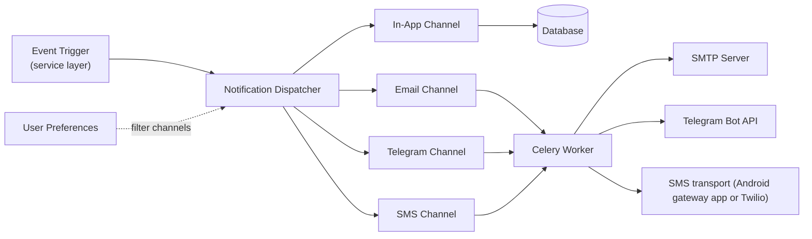

# Notifications

Revel has a multi-channel notification system that delivers messages through **in-app notifications**, **email**, **Telegram**, and (opt-in) **SMS**. The system is designed to be extensible, user-configurable, and respectful of user preferences.

## Architecture



## Channels

| Channel | Delivery | Templates | Notes |
|---|---|---|---|
| **In-App** | Immediate (database) | `notifications/templates/notifications/in_app/` | Stored as model instances, queryable via API |
| **Email** | Async (Celery) | Django email templates | Supports HTML and plain text |
| **Telegram** | Async (Celery) | `notifications/templates/notifications/telegram/` | Markdown-formatted messages via bot |
| **SMS** | Async (Celery) | `notifications/templates/notifications/sms/` | Plain text, one or two GSM-7 segments. Opt-in per deployment (`FEATURE_SMS`), allow-listed types only, verified phone required. See [SMS channel](#sms-channel) |

!!! tip "User preferences control everything"
    Users can configure which channels receive which notification types. The dispatcher respects these preferences before sending. Notifications also support **digest mode** for batching.

## Notification Types

The following notification types are supported across all channels:

### Event Notifications

| Type | Description |
|---|---|
| `event_cancelled` | An event the user RSVP'd to has been cancelled |
| `event_open` | An event is now open for registration |
| `event_reminder` | Reminder before an upcoming event |
| `event_updated` | Event details have changed |

### Invitation & Membership

| Type | Description |
|---|---|
| `invitation_received` | User received an event invitation |
| `invitation_request_created` | Someone requested an invitation (staff notification) |
| `membership_promoted` | User's membership role was upgraded |
| `membership_removed` | User was removed from an organization |
| `membership_request_approved` | Membership request was approved |
| `membership_request_rejected` | Membership request was rejected |
| `membership_request_created` | Someone requested membership (staff notification) |
| `membership_granted` | User was granted membership directly |

### Tickets & Payments

| Type | Description |
|---|---|
| `ticket_created` | Ticket was successfully created |
| `ticket_cancelled` | Ticket was cancelled |
| `ticket_refunded` | Ticket payment was refunded |
| `ticket_updated` | Ticket details were updated |
| `payment_confirmation` | Payment was processed successfully |
| `rsvp_confirmation` | RSVP was confirmed |
| `rsvp_updated` | RSVP details were updated |
| `rsvp_cancelled` | RSVP was cancelled |

!!! note "`ticket_checked_in` is no longer dispatched (1.64.0)"
    The `ticket_checked_in` enum value (and its template/context scaffolding) still
    exists, but no notification is sent on check-in — the holder is already at the
    event, so the message was pure noise.

### Transactional types (bypass the digest)

The **transactional** types (`TRANSACTIONAL_TYPES` in `notifications/enums.py`) are the
payment, ticket and subscription lifecycle types: `payment_confirmation`, `ticket_created`,
`ticket_cancelled`, `ticket_refunded`, and the five `subscription_*` receipts and alerts.

These are time- and money-sensitive, so they **always deliver immediately and bypass the digest
cadence**. Together with `account_banned` and `system_announcement` they form `MANDATORY_TYPES`,
which users can't opt out of. See
[Email Sending & Opt-Out Policy](email-sending.md#mail-users-cant-opt-out-of). Every other type
honours the user's digest setting (digest users get the in-app notification now and the email in
the next digest sweep).

### Waitlist & Availability

| Type | Description |
|---|---|
| `waitlist_spot_available` | A reserved offer was issued to the user. Carries `expires_at`, `is_cutoff_batch`, and event context. See [Advanced Waitlist](waitlist.md). |

### Questionnaires

| Type | Description |
|---|---|
| `questionnaire_submitted` | A questionnaire submission was received (staff notification) |
| `questionnaire_evaluation_result` | Evaluation result sent to the user |

### Potluck

| Type | Description |
|---|---|
| `potluck_item_created` | A new potluck item was added |
| `potluck_item_created_and_claimed` | A potluck item was added and claimed in one action |
| `potluck_item_claimed` | Someone claimed a potluck item |
| `potluck_item_unclaimed` | A potluck claim was removed |
| `potluck_item_updated` | A potluck item was updated |
| `potluck_item_deleted` | A potluck item was deleted |

### Whitelist Requests

| Type | Description |
|---|---|
| `whitelist_request_created` | User requested whitelist access (staff notification) |
| `whitelist_request_approved` | Whitelist request was approved |
| `whitelist_request_rejected` | Whitelist request was rejected |

### Account

| Type | Description |
|---|---|
| `account_banned` | User's account has been banned from the platform |

### Organization setup

| Type | Description |
|---|---|
| `org_setup_nudge` | Capped reminder to the owner of a stalled organization (forgotten draft, private profile, no events, check-in, gone quiet). Opt-out-able. See [Org setup nudges](email-sending.md#org-setup-nudges) |

### Announcements

| Type | Description |
|---|---|
| `org_announcement` | Organization-wide announcement |
| `system_announcement` | Platform-wide notice (Terms of Service, privacy policy, operational). Can't be opted out of, so never promotional |

!!! note "Announcements can be sent now or scheduled"
    Org announcements can be **sent immediately**, **scheduled** for a future absolute
    or event-relative time, and optionally **re-sent** to attendees who sign up after the
    first send — all delivered as `org_announcement` notifications through this dispatcher.
    See [Scheduled Announcements](scheduled-announcements.md).

### Following

| Type | Description |
|---|---|
| `new_event_from_followed_org` | A followed organization published a new event |
| `new_event_from_followed_series` | A new event was added to a followed series |
| `organization_followed` | Someone followed an organization (org staff notification) |
| `event_series_followed` | Someone followed an event series (org staff notification) |

## Template Structure

Templates are organized by channel under `src/notifications/templates/notifications/`:

```
notifications/
  templates/
    notifications/
      in_app/
        event_cancelled.md
        event_open.md
        ...
      email/
        event_cancelled.html
        event_cancelled.txt
        ...
      emails/
        digest.html
        digest.txt
      telegram/
        event_cancelled.md
        event_open.md
        ...
```

!!! note "Template formats"
    Both in-app and Telegram templates use Markdown (`.md` files). Email templates use Django's standard template system with `.html` and `.txt` variants.

## User Preferences

Users configure their notification preferences per channel and per type. The preference model supports:

- **Per-channel toggles**: Enable/disable each channel independently
- **Per-type toggles**: Fine-grained control over which notifications to receive
- **Digest mode**: Batch notifications into periodic summaries instead of sending individually (does not apply to the [transactional types](#transactional-types-bypass-the-digest), which always deliver immediately)
- **Per-organization announcement mute**: Stop one organization's announcements without touching anything else

!!! info "Defaults"
    New users receive most notification types on all available channels by default. Exceptions: **potluck notifications** are restricted to in-app only (no email or Telegram) and **guest users** have potluck notifications disabled entirely. Telegram notifications always require the user to have linked their Telegram account.

## Implementation Details

The notification system is implemented in `notifications/service/`, which includes:

- **Dispatcher**: Routes notifications to the appropriate channels based on user preferences
- **Eligibility checks**: Determines which users should receive a given notification (e.g., only attendees of an event)
- **Reminder scheduling**: Schedules event reminders via Celery Beat periodic tasks
- **Digest batching**: Aggregates notifications into periodic digest emails
- **Unsubscribe handling**: Manages per-type and per-channel opt-outs, one-click `List-Unsubscribe`, the per-organization announcement mute and the email suppression list (see [Email Sending & Opt-Out Policy](email-sending.md))

Notifications are triggered from the service layer via Django signals and direct dispatcher calls. Delivery for email and Telegram channels is always asynchronous via Celery tasks.

!!! info "Digest email (overhauled in 1.64.0)"
    The digest groups its notifications by **human-readable type label** (e.g. "Event
    Reminder"). Each item carries its body, a timestamp, and a **"View details"** link
    derived from the notification's context, and the whole email is restyled to match
    the transactional email templates. See `NotificationDigest._build_notification_groups`
    in `notifications/service/digest.py`.

!!! info "Event times render in the event's timezone (1.64.0)"
    Event times in notifications and emails are always rendered in the **event's own
    timezone** (via `format_event_datetime`), not the recipient's or the server's.

## SMS channel

SMS is deliberately **not** a peer of email: texts cost money (or come off a personal phone
plan) and carriers filter chatty senders, so it is gated three ways.

- **Deployment opt-in** — `FEATURE_SMS` (default `False`) plus a transport in `settings/sms.py`.
  `SMS_BACKEND` is a dotted path to a `send(*, to, body) -> str` callable; `SMS_DRY_RUN=True`
  swaps in the console backend (logs instead of sending, same as `EMAIL_DRY_RUN`). Two
  transports ship:
    - `sms.backends.android_gateway` (default) — [SMS Gateway for Android](https://docs.sms-gate.app)
      in Local Server mode: an HTTP API on a phone the backend can reach (LAN or VPN),
      `SMS_GATEWAY_URLS` tried in order, Basic Auth. Delivery receipts and inbound replies come
      back through `POST /api/webhooks/sms-gateway/` (HMAC-SHA256 `X-Signature` over body +
      `X-Timestamp`, deduplicated in `SmsGatewayEvent`). `manage.py register_sms_gateway_webhooks`
      subscribes the app; `sms.check_gateway_health` (Beat, every 30 min) pings it and sends one
      Pushover alert per outage.
    - `sms.backends.twilio` — prefers a Messaging Service so STOP/START handling and
      geo-permissions live at the provider.
- **Type allowlist** — only `SMS_ELIGIBLE_TYPES` (`notifications/enums.py`: event reminders,
  ticket created, event cancelled, waitlist spot available, invitation received) ever reach the
  channel. The dispatcher strips SMS from every other type, including the mandatory ones that
  force in-app and email, so a user enabling SMS globally never receives terms notices or
  receipts by text. Each eligible type ships its own `sms/<type>.txt` template, written for the
  medium (plain text, ASCII punctuation, a single full-domain link); a test asserts GSM-7 and
  ≤ 2 segments.
- **Verified phone** — SMS goes only to a number with `phone_verified_at` set. Two ways to get
  there, recorded in `phone_verification_source`:
    - *self* — the user verifies their own number (`POST /api/sms/phone/request-code` → code
      texted → `POST /api/sms/phone/verify`). Codes are 6 digits, expire after
      `SMS_OTP_EXPIRATION_MINUTES`, allow `SMS_OTP_MAX_ATTEMPTS` guesses, and requests are
      rate-limited and restricted to `SMS_ALLOWED_COUNTRY_PREFIXES` (default `+1`) to blunt
      SMS-pumping fraud. A confirmation text with the STOP wording follows.
    - *host* — an organizer with member management sets a member's number through
      `PUT /organization-admin/{slug}/members/{user_id}` (`phone_number`; `null` clears). The
      number is validated, allow-listed and checked against bans and the opt-out list, then
      stamped verified and SMS is enabled in the member's preferences. **No code and no
      consent text are sent** — this is for hosts adding people they know. A STOP reply is
      still honoured.

### Phone-only guests

People who never create an account can still be invited and reminded by text. `POST
/event-admin/{event_id}/invitations` accepts `phone_numbers` next to `emails`: each number
becomes (or resolves to) a **phone-only guest** — a regular `guest=True` user whose email is
the synthetic `<E.164 digits>@SMS_ONLY_EMAIL_DOMAIN` (`sms.synthetic_email`) and whose number
is pre-verified by the host — plus a real `EventInvitation` and a `GuestAccessLink`. The
invitation notification's SMS carries `<frontend>/g/<code>`; `GET /api/events/guest-link/{code}`
shows the event and `POST /api/events/guest-link/{code}/rsvp/{answer}` RSVPs as that user with
no login — the text already proved possession of the number. Links expire 7 days after the
event ends; reminder texts to phone guests carry the same link. Requires `FEATURE_SMS` and a
non-empty `SMS_ONLY_EMAIL_DOMAIN`.

The synthetic address is an identity key, never a mailbox. The digits sit in the local part
on a dedicated subdomain (`normalize_email_for_matching` strips `+tags`, so `sms+digits@`
would collide). Nothing is ever mailed to it: `email_policy.may_email` / `suppression_for`
refuse it, and with `SMS_ONLY_EMAIL_DOMAIN` set the configured `EMAIL_BACKEND` is wrapped by
`sms.email_backend.SmsOnlyFilteringBackend` (the real backend moves to
`SMS_INNER_EMAIL_BACKEND`), which drops such recipients from every `EmailMessage` — account
mail, guest confirmations, invoices included.

**Merging into a real account.** When someone who was invited by text later registers and
verifies that same number (or a host sets it on their account), the phone-only guest is
absorbed: `accounts.service.user_merge.merge_users` re-points every relation onto the real
account (RSVPs, invitations, guest links, tickets, notifications, ...), lets the target's row
win on unique collisions (an RSVP to the same event, preferences), and deletes the guest. The
texted `/g/<code>` link keeps working for the real account. Only a *phone-only guest* is
absorbed this way; a number held by a real account still blocks verification.

Delivery runs through `sms.tasks.send_sms_task`, the single send path for notifications,
verification codes and confirmations. It enforces the `SmsOptOut` list (fed by STOP replies
via the gateway webhook, or provider "opted out" errors), the `SMS_MONTHLY_LIMIT` runaway cap
(admin Pushover ping when hit), retries transient transport errors on a per-purpose schedule
(notifications for hours so a phone that is off overnight still delivers; verification codes
only briefly, they expire anyway), is rate-limited to one text a second, writes an `SmsLog` row
per send (no body stored), and reports back to `NotificationDelivery` through the same
allow-listed callback mechanism as Telegram, storing the transport message id in
`delivery.metadata` so the gateway's `sms:sent` / `sms:delivered` / `sms:failed` webhooks can
update it later.

!!! warning "`FEATURE_TELEGRAM` strips the Telegram channel platform-wide"
    When `FEATURE_TELEGRAM` is off (self-host without a bot), the dispatcher strips the
    Telegram channel from every notification's delivery list — no Telegram delivery is
    ever enqueued, regardless of a user's per-channel preference. See
    [Telegram Bot → Configuration](../guides/telegram-bot.md).

## Admin Pings (Pushover & Discord)

Separate from the main user-facing notification system, Revel dispatches **admin-only** pings when operationally interesting events happen on the platform. These never reach end users and do not create `Notification` records; they go directly to Pushover and/or a Discord webhook.

| Event | Pushover content | Discord content |
|---|---|---|
| New user signs up | User email, referrer email (if any), running user count | Generic "A new user joined" + running user count (no PII) |
| New organization created | Org name, owner email, running org count | Org name, owner email, running org count |

Each channel self-skips when its config is missing:

- **Pushover** requires `PUSHOVER_USER_KEY` + `PUSHOVER_APP_TOKEN`.
- **Discord** requires `DISCORD_ADMIN_WEBHOOK_URL`.

Dispatch is gated by `SiteSettings` flags:

- `notify_user_joined` → new-user pings (both channels)
- `notify_organization_created` → new-organization pings (both channels)

Tasks live in `accounts/tasks.py` (user) and `events/tasks.py` (organization); signals in the corresponding `signals.py` dispatch them via `transaction.on_commit` so any related rows (e.g., `Referral`) are visible when the task runs. All tasks retry with exponential backoff (1/2/4 min, max 3 attempts).
